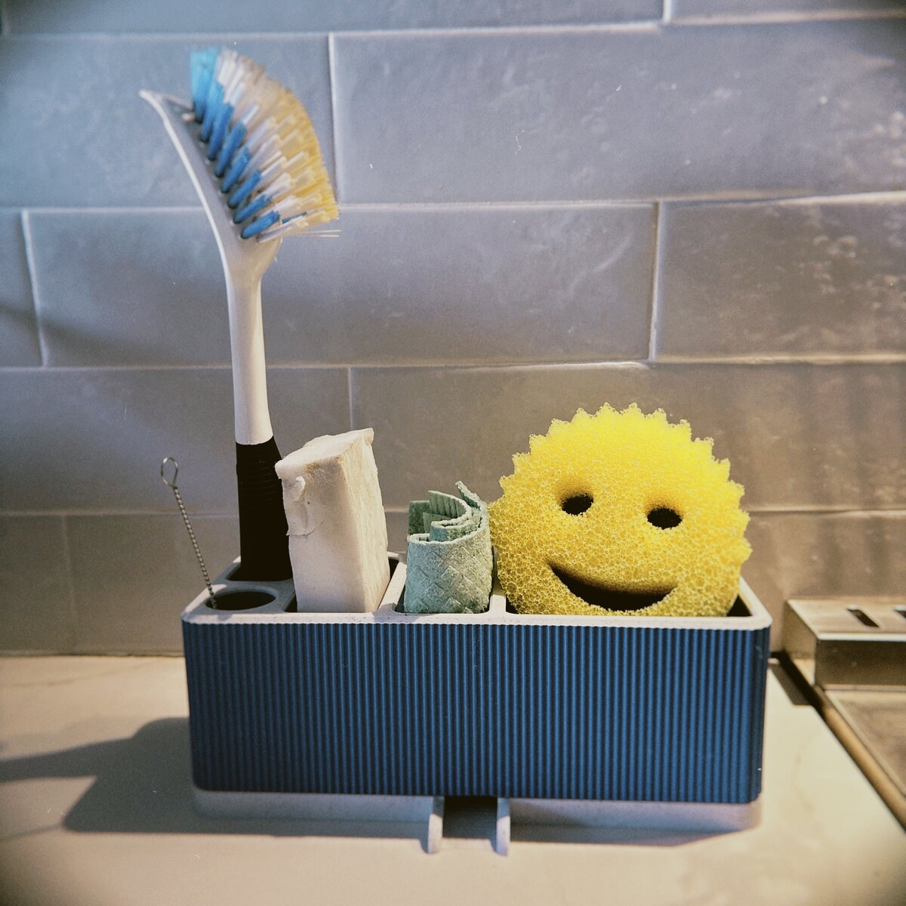
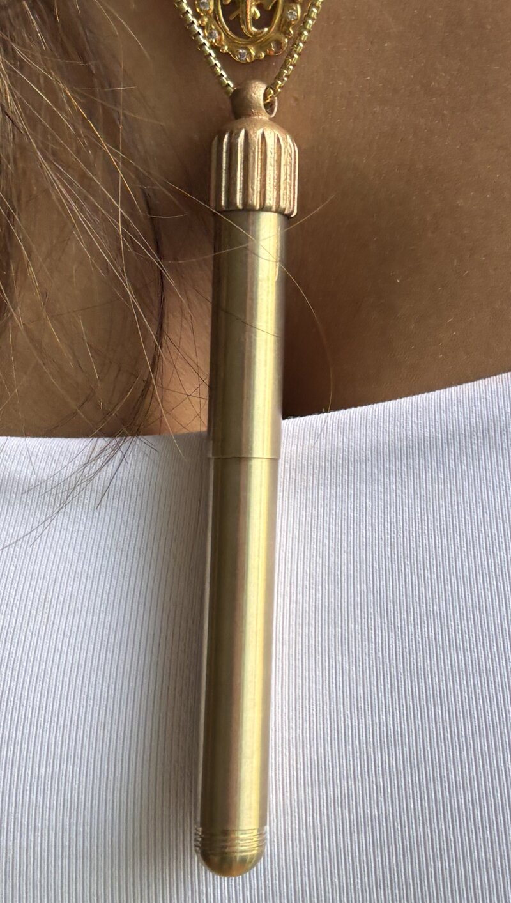

# Models

Things I've designed in Rhino for the 3D printer. Each folder has the printable files (`.stl`, or `.3mf` with Bambu Studio print settings) and, where I have it, the Rhino source (`.3dm`), Grasshopper definitions (`.gh`) or a Rhino Python script.

## Kitchen organizer

A kitchen sink organizer, 206 × 83 mm, with slots for a dish brush, soap and sponges and ribbed outer walls.

- `My_Kitchen_Organizer_top.stl`, `My_Kitchen_Organizer_bottom.stl`: printable parts
- `Kitchen_org_top_fill.3dm`: Rhino source for the top
- `generator.py`: Rhino Python script that builds the base shape
- `voronai.gh`, `textured_wall_arrayer.gh`: Grasshopper definitions for the wall texture

## Pendant

A fluted bail for a pendant, plus a box insert to hold it.

- `fluted_bail_v8.stl`, `fluted_bail_v7.stl`: the last two versions of the bail
- `fluted_bail_v4_print.3mf`: Bambu Studio project (A1, 0.2 mm nozzle, 0.1 mm layers)
- `fluted_bail_v3.3dm`: Rhino source
- `bail_generator.gh`: Grasshopper definition that generates the bail
- `box_insert_v1_fixed.stl`, `box_insert.3dm`: box insert, printable and Rhino source

## Planter

A planter modelled in Rhino. Not printed yet.

- `planter_top.stl`, `planter_base.stl`: printable parts
- `akari_planter_model_v1.3dm`: Rhino source

## License

[CC BY-NC 4.0](LICENSE): free to print, share and remix for non-commercial use, with credit.
